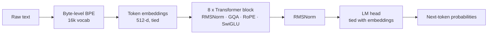
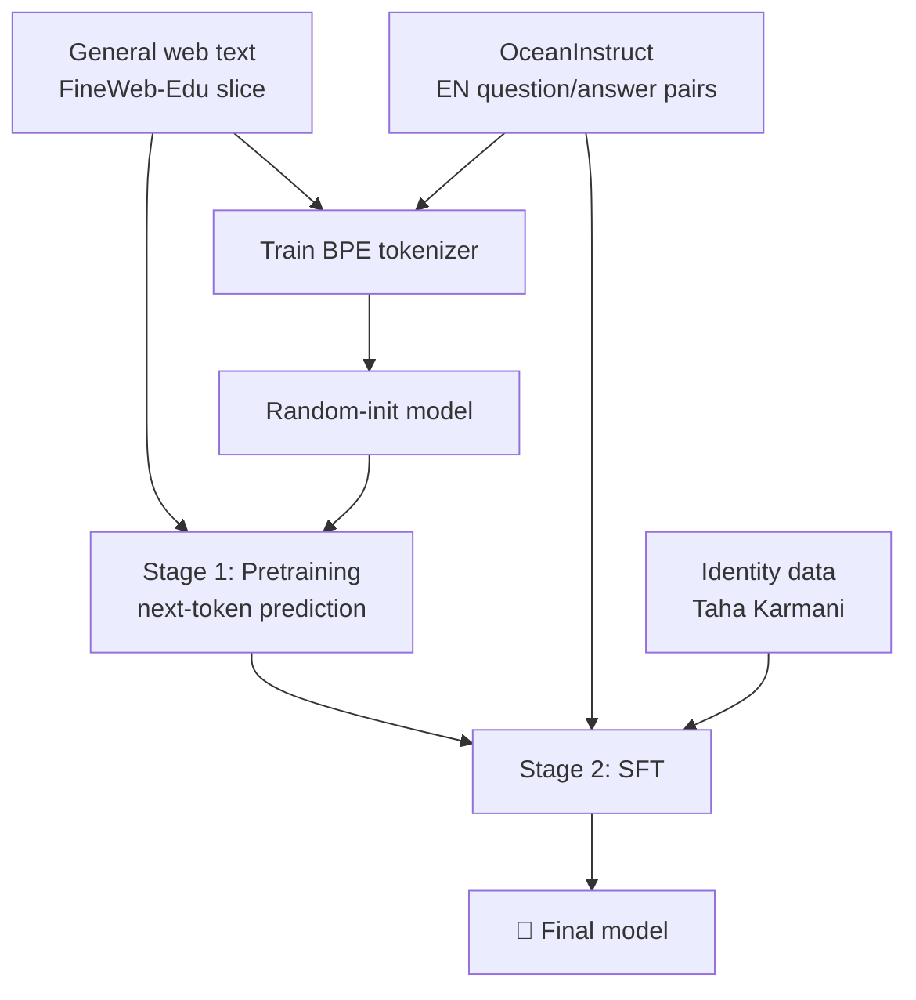

<div align="center">

# 🌊 Taha Karmani

### A small language model built **entirely from scratch** to talk about the ocean

[](https://www.python.org/)
[](https://pytorch.org/)
[](https://huggingface.co/docs/transformers)
[](https://www.kaggle.com/)
[](LICENSE)
[](https://huggingface.co/your-username/taha-karmani)

[**Animated Demo**](#-animated-demo) · [**Quickstart**](#-quickstart) · [**Architecture**](#-architecture) · [**Training**](#-training-pipeline) · [**Limitations**](#-limitations)

</div>

---

## 📖 Overview

**Taha Karmani** is a compact decoder-only transformer language model, trained **from zero**: no pretrained weights, no borrowed tokenizer, no fine-tuning of an existing model such as Qwen or Llama.

Every layer of the stack was built and trained in this project:

| Stage | What was done |
|---|---|
| 🔤 **Tokenizer** | Custom byte-level BPE tokenizer (16k vocabulary) trained on the project corpus |
| 🧠 **Architecture** | Llama-style transformer with **randomly initialised** weights (~32M parameters) |
| 📚 **Pretraining** | Causal language modelling on a general English web-text corpus |
| 💬 **Instruction tuning** | Supervised fine-tuning on ocean-domain Q&A plus identity data |
| ☁️ **Hardware** | Free Kaggle GPUs (2× NVIDIA T4, fp16) |

> 🎯 **Goal:** understand and demonstrate the full life cycle of a language model (data, tokenizer, architecture, pretraining, fine-tuning, inference) on a limited compute budget.

---

## 🎬 Animated Demo

<div align="center">

### ▶️ [Watch the animated explainer](https://your-username.github.io/taha-karmani/)

*An auto-playing, in-browser walkthrough: data → tokenizer → architecture → training → chat. Source: [`docs/index.html`](docs/index.html)*

</div>

### Example conversation

```text
<|user|>Who are you?<|assistant|>
I am Taha Karmani, a small language model trained from scratch to talk about the ocean and the sea.

<|user|>Why are coral reefs important?<|assistant|>
(paste a real output from your final model here)
```

> ⚠️ Replace the second answer with a real generation from your trained checkpoint. Honest examples build more trust than polished ones.

---

## 🏗 Architecture



| Hyper-parameter | Value |
|---|---|
| Model type | Decoder-only transformer (Llama-style) |
| Parameters | ≈ 32M |
| Layers | 8 |
| Hidden size | 512 |
| MLP size | 1408 (SwiGLU) |
| Attention heads | 8 (4 key/value heads, grouped-query attention) |
| Context length | 1024 tokens |
| Vocabulary | 16,000 (byte-level BPE) |
| Positional encoding | Rotary (RoPE) |
| Precision | fp16 mixed precision |

### Special tokens

| Token | Purpose |
|---|---|
| `<\|pad\|>` | Padding |
| `<\|bos\|>` | Beginning of sequence |
| `<\|eos\|>` | End of sequence / end of answer |
| `<\|user\|>` | Start of the user message |
| `<\|assistant\|>` | Start of the model answer |

---

## 🔬 Training Pipeline



### Stage 1: Pretraining
- Objective: causal language modelling (next-token prediction)
- Data: educational web text, packed into 1024-token blocks
- Optimiser: AdamW, cosine schedule, 200 warm-up steps, peak LR `6e-4`
- Effective batch size: 64 sequences (8 × 8 gradient accumulation)

### Stage 2: Supervised fine-tuning
- Data: [`zjunlp/OceanInstruct`](https://huggingface.co/datasets/zjunlp/OceanInstruct) (English columns) + hand-written identity examples
- Chat format: `<|user|>{question}<|assistant|>{answer}<|eos|>`
- 2 epochs, LR `5e-5`

### Training curves

| Metric | Value |
|---|---|
| Final pretraining loss | _fill in_ |
| Final SFT loss | _fill in_ |
| Total GPU time | _fill in_ |

---

## 🚀 Quickstart

### 1. Install

```bash
git clone https://github.com/your-username/taha-karmani.git
cd taha-karmani
pip install -U transformers torch datasets tokenizers accelerate
```

### 2. Chat with the model

```python
import torch
from transformers import AutoTokenizer, AutoModelForCausalLM

repo = "your-username/taha-karmani"   # or a local folder, e.g. "./ocean-llm-final"
tokenizer = AutoTokenizer.from_pretrained(repo)
model = AutoModelForCausalLM.from_pretrained(repo, torch_dtype=torch.float16).to("cuda")

def ask(question, max_new_tokens=120):
    prompt = f"<|user|>{question}<|assistant|>"
    ids = tokenizer(prompt, return_tensors="pt", return_token_type_ids=False).to(model.device)
    out = model.generate(
        **ids,
        max_new_tokens=max_new_tokens,
        do_sample=True,
        temperature=0.6,
        top_p=0.9,
        repetition_penalty=1.3,
        no_repeat_ngram_size=3,
        eos_token_id=tokenizer.eos_token_id,
    )
    text = tokenizer.decode(out[0], skip_special_tokens=False)
    return text.split("<|assistant|>")[-1].replace("<|eos|>", "").strip()

print(ask("Who are you?"))
print(ask("What lives in the deep sea?"))
```

### 3. Reproduce the training

Open the notebook on Kaggle and run it with **GPU T4 ×2** and **Internet On**:

```text
notebooks/train_from_scratch.ipynb
```

> 💡 Use **Save Version → Save & Run All (Commit)** so the run continues in the background and the outputs are kept.

---

## 📂 Repository structure

```text
taha-karmani/
├── docs/
│   └── index.html             # animated explainer (GitHub Pages)
├── notebooks/
│   └── train_from_scratch.ipynb
├── src/
│   ├── tokenizer.py           # BPE tokenizer training
│   ├── pretrain.py            # stage 1
│   ├── sft.py                 # stage 2
│   └── chat.py                # inference
├── README.md
└── LICENSE
```

---

## 📊 Data

| Dataset | Used for | Link |
|---|---|---|
| FineWeb-Edu (sample) | Tokenizer + pretraining | [HuggingFaceFW/fineweb-edu](https://huggingface.co/datasets/HuggingFaceFW/fineweb-edu) |
| OceanInstruct | Tokenizer + instruction tuning | [zjunlp/OceanInstruct](https://huggingface.co/datasets/zjunlp/OceanInstruct) |
| Identity Q&A | Name and persona | Written by hand (in this repo) |

Please check each dataset's licence before redistributing the model or derived data.

---

## ⚠️ Limitations

This is an **educational, small-scale model**. Be realistic about what it can do:

- 🧩 With ~32M parameters and a limited training budget, answers can be **repetitive, vague, or factually wrong**.
- 🌍 It knows mostly what appeared in its training data (a large share of OceanInstruct concerns marine engineering and regional topics).
- 🗣 English only.
- 🚫 **Do not use it for navigation, safety, scientific, or medical decisions.**

---

## 🗺 Roadmap

- [x] Custom BPE tokenizer
- [x] Pretraining from random initialisation
- [x] Instruction tuning on ocean data
- [ ] Longer pretraining on a larger corpus
- [ ] Add marine-biology Wikipedia text to pretraining
- [ ] Evaluation on a held-out ocean Q&A set
- [ ] Gradio web demo on Hugging Face Spaces
- [ ] Scale to 100M+ parameters

---

## 🙏 Acknowledgements

- [zjunlp](https://github.com/zjunlp) for the **OceanInstruct** dataset
- [Hugging Face](https://huggingface.co/) for `transformers`, `datasets`, and `tokenizers`
- [Kaggle](https://www.kaggle.com/) for free GPU compute

---

## 📜 Citation

```bibtex
@misc{tahakarmani2026,
  title  = {Taha Karmani: A Small Ocean Language Model Trained From Scratch},
  author = {Your Name},
  year   = {2026},
  url    = {https://github.com/your-username/taha-karmani}
}
```

---

## 📄 License

Released under the [MIT License](LICENSE). Dataset licences apply to the training data.

<div align="center">

**If you like this project, give it a ⭐ and share it!**

Built with 🌊 and curiosity.

</div>
